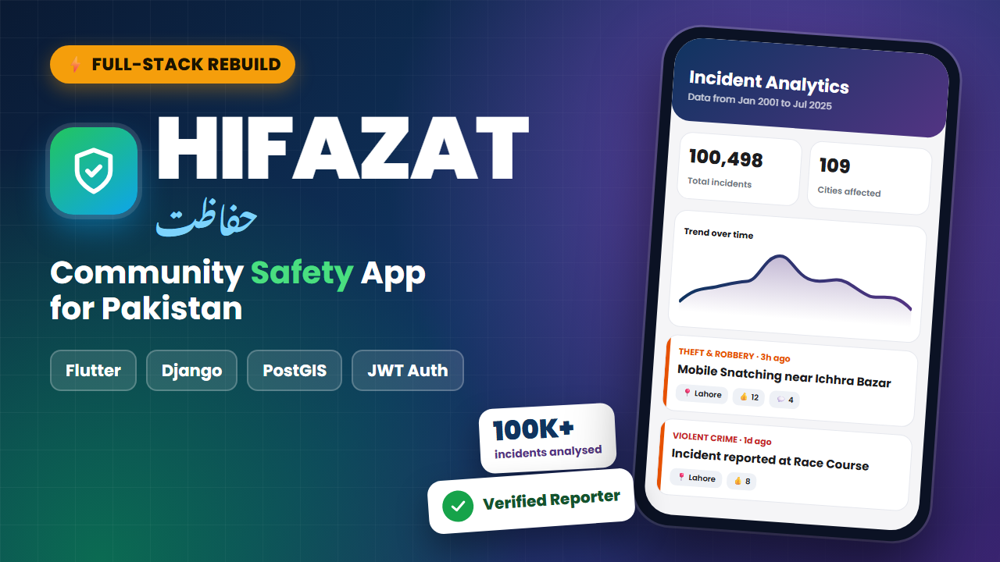
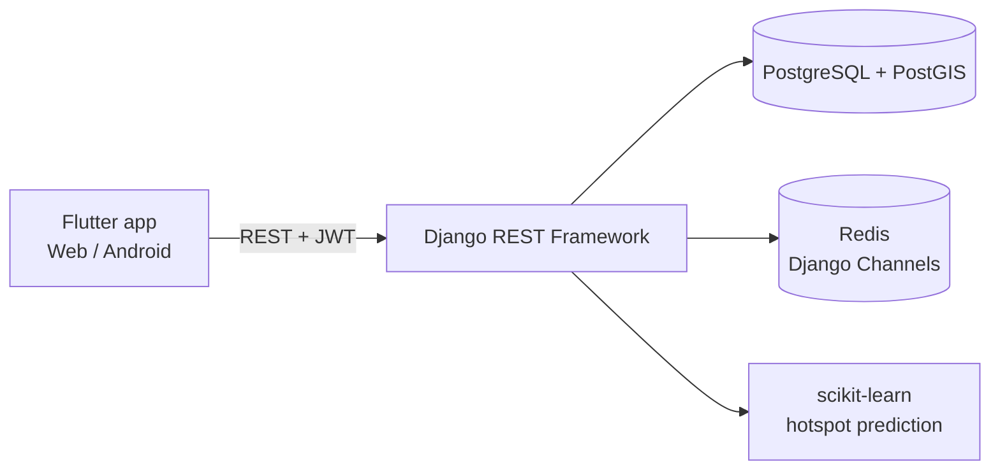

<p align="center">
  
</p>

<h1 align="center">Hifazat (حفاظت)</h1>
<p align="center"><b>A community-driven safety awareness app for Pakistan</b><br>
Final Year Project · Flutter · Django REST Framework · PostgreSQL/PostGIS</p>

---

## Overview

**Hifazat** ("protection" in Urdu) helps citizens stay aware of safety incidents around them. People report incidents such as theft, violent crime or accidents, the community verifies them through votes and comments, and everyone can explore trends through an analytics dashboard.

The database is seeded with **100,498 historical incidents across 109 cities** (2001–2025) to power the map, feed and analytics.

## Features

| Area | What it does |
|---|---|
| 🔐 **Authentication** | JWT login and registration, automatic token refresh with rotation, server-side logout (token blacklist), role-based access (citizen / admin) |
| 🗺️ **Map & heatmap** | Incidents on an interactive OpenStreetMap map with a density heatmap and predicted hotspots (kernel density estimation) |
| 📰 **Incidents feed** | Infinite-scroll feed with category styling, filters and search, up/down votes, and inline comment threads |
| 📝 **Reporting** | Report an incident with category, description, date and a location picked on the map |
| 📊 **Analytics** | Server-side aggregated dashboard: totals, trend over time, category breakdown, top cities, day-of-week patterns, and time filters (7 days / 30 days / 12 months / all time) |
| 👤 **Profile & reputation** | Verified-reporter badge, reputation score and levels (Newcomer → Contributor → Guardian → Champion) |

## Architecture



- **Backend:** Django 4.2, Django REST Framework, GeoDjango/PostGIS for spatial queries, SimpleJWT for auth, and Channels with Redis.
- **Frontend:** Flutter with Provider state management, Dio HTTP client, flutter_map, and fl_chart.

## Repository structure

```
Hifazat-FYP/
├── backend/            Django REST API
│   ├── api/            models, serializers, views, permissions, management commands
│   ├── config/         project settings and URLs
│   └── .env.example    environment variables template
├── frontend/           Flutter app
│   ├── lib/
│   │   ├── api/        HTTP client, models and services
│   │   ├── providers/  state management
│   │   ├── screens/    app screens (map, feed, analytics, profile, auth, …)
│   │   └── widgets/    reusable UI components
│   └── test/           widget tests
└── docs/               images
```

## Getting started

### 1. Backend (Linux / WSL recommended)

GeoDjango needs GDAL, so a Linux environment (or WSL on Windows) is the easiest setup.

```bash
# System packages (Ubuntu)
sudo apt install python3-venv postgresql postgis gdal-bin libgdal-dev redis-server

# Database
sudo -u postgres psql -c "CREATE USER hifazat_user WITH PASSWORD 'your_db_password';"
sudo -u postgres psql -c "CREATE DATABASE hifazat_db OWNER hifazat_user;"
sudo -u postgres psql -d hifazat_db -c "CREATE EXTENSION postgis;"

# App
cd backend
python3 -m venv venv && source venv/bin/activate
pip install -r requirements.txt
cp .env.example .env          # then edit .env with your values
python manage.py migrate
python manage.py createsuperuser

# (Optional) import incident data from CSV
python manage.py import_incidents path/to/incidents.csv --user <superuser>

python manage.py runserver 0.0.0.0:8000
```

The API is now at `http://127.0.0.1:8000/api/` and the admin panel at `http://127.0.0.1:8000/admin/`.
See [backend/README.md](backend/README.md) for detailed setup and the full endpoint list.

### 2. Frontend

Requires the [Flutter SDK](https://docs.flutter.dev/get-started/install) (3.32 or newer).

```bash
cd frontend
flutter pub get
flutter run -d chrome
```

The API URL is set in `frontend/lib/utils/constants.dart` (`apiBaseUrl`):

| Running on | Use |
|---|---|
| Web / desktop | `http://127.0.0.1:8000/api` |
| Android emulator | `http://10.0.2.2:8000/api` |
| Physical phone | `http://<your-PC-LAN-IP>:8000/api` (same Wi-Fi) |

### 3. Tests

```bash
cd frontend && flutter test
```

## Key API endpoints

| Method | Endpoint | Description |
|---|---|---|
| POST | `/api/auth/register/` | Create an account |
| POST | `/api/auth/login/` | Get access and refresh tokens |
| POST | `/api/auth/refresh/` | Refresh the access token (rotates the refresh token) |
| POST | `/api/auth/logout/` | Blacklist the refresh token |
| GET | `/api/users/me/` | Current user, role and verified status |
| GET | `/api/incidents/` | Paginated incidents (GeoJSON), with filters, search and ordering |
| POST | `/api/incidents/` | Report an incident |
| GET | `/api/incidents/stats/?period=all\|year\|month\|week` | Aggregated analytics |
| POST | `/api/incidents/{id}/upvote/` · `/downvote/` | Vote on an incident |
| GET/POST | `/api/incidents/{id}/comments/` | List or add comments |
| GET | `/api/predict/hotspots/` | Predicted incident hotspots |

## Tech stack

**Frontend:** Flutter, Dart, Provider, Dio, flutter_map, fl_chart, Font Awesome
**Backend:** Python, Django, Django REST Framework, SimpleJWT, GeoDjango, Django Channels, scikit-learn
**Data:** PostgreSQL, PostGIS, Redis

## Author

**Muhammad Talha Khan** · Final Year Project
